<h1 align="center">GitHub Actions Manager for JetBrains IDEs</h1>

  <b>Your CI, one tool window away.</b> 
  Watch runs, read logs, re-run, dispatch, approve deployments and manage Actions secrets —
  in IntelliJ IDEA, PyCharm, WebStorm, GoLand, Rider and the other JetBrains IDEs.

  
  
  

  <a href="https://plugins.jetbrains.com/plugin/19347-github-actions-manager"><b>Install from the Marketplace</b></a>
  &nbsp;·&nbsp;
  <a href="https://youtu.be/nFrs8W2gSC8">Watch the demo</a>
  &nbsp;·&nbsp;
  <a href="CHANGELOG.md">What's new</a>
  &nbsp;·&nbsp;
  <a href="https://github.com/dsoftwareinc/ghactions-manager/issues">Report an issue</a>

  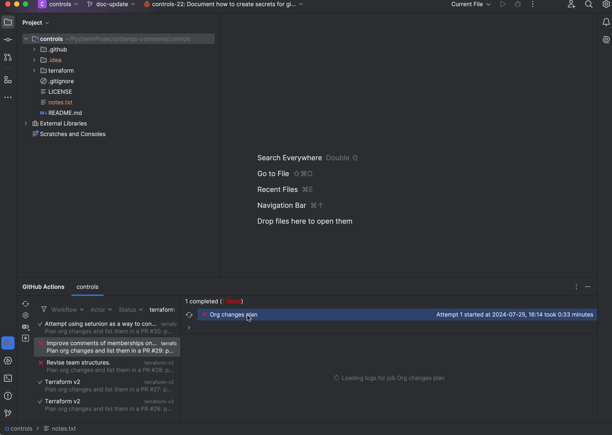

## Why you'll want it

- **Stop tab-juggling.** The run your push just triggered is already in the IDE, filtered to the branch you're on.
- **Read logs like code.** One job, split step by step, foldable, searchable with <kbd>⌘F</kbd> / <kbd>Ctrl+F</kbd> —
  not one endless web page.
- **Fix it where it broke.** Click a failed check's annotation to land on the file and line, fix, push, and watch the
  re-run from the same window.
- **Works where the browser is a chore.** GitHub Enterprise Server behind a VPN, an HTTP proxy, a corporate
  certificate — the plugin uses the IDE's own network settings.

Viewing runs, jobs and logs is **free, forever**. Acting on them (re-run, dispatch, approve, artifacts, repository
settings) comes with a license: **[start a free 30-day trial][marketplace]**.

<!-- Plugin description -->
**The missing GitHub Actions UI for JetBrains IDEs.** GitHub ships an official Actions extension for VS Code — JetBrains
users get this plugin instead: watch workflow runs live, read step-by-step logs, re-run and dispatch workflows, approve
deployments, and manage Actions secrets and variables, all without leaving the IDE.

Works with GitHub.com **and GitHub Enterprise Server**, through the IDE's proxy and certificate settings — if your
server lives behind a VPN, this is the fastest way to follow a run or approve a deployment.

**Why an IDE plugin instead of the browser or the `gh` CLI?**

- No tab-juggling: the run triggered by your push is one tool window away, filtered to your current branch.
- Logs are split per step and rendered in the IDE, instead of one giant scrolling page.
- A failed run is fixable on the spot — jump to the workflow file or the annotated line, fix, push, watch the re-run.

Viewing runs, jobs, and logs is **free, forever**. Advanced features (dispatch, re-run/cancel, deployment approval,
artifacts, repository settings) come with a license —
[start a free 30-day trial on the JetBrains Marketplace](https://plugins.jetbrains.com/plugin/19347-github-actions-manager),
or fill [this form](https://docs.google.com/forms/d/e/1FAIpQLSe7Nmpz8UcjQh493pwMnuKCdM17uOqIdCOhwEjWUc77wzwrHg/viewform?usp=header)
to receive a discount code.

### Watch your workflows (free)

- **Live runs list** that refreshes on its own (every 30 seconds by default), with one tab per repository in
  multi-repository projects.
- **Filters** by branch, actor, event, status and workflow — alone or combined — plus a *current branch* filter that
  follows you when you switch branches.
- **Jobs as a tree**: matrix and reusable-workflow jobs are grouped under their parent, each group showing a combined
  status.
- **Step-by-step logs** in a real editor console: fold steps, search with <kbd>⌘F</kbd> / <kbd>Ctrl+F</kbd>, soft-wrap.
  A running job shows its steps as they progress.
- **Details on hover**: what triggered a run, its attempt and duration; a job's runner, labels, branch, commit and
  timing.
- **From wherever you are**: *Show in GitHub Actions* on a commit in the Git log, *Show Runs* in the toolbar above a
  workflow file, and opening a workflow file filters the list to that workflow.
- **Told when it matters**: a notification when a run of your branch fails — one click to the failed step of the
  failed job — and one when all the runs of a push have passed.

### Act on them (license required)

- **Your branch's CI in the status bar**: passed, failed or still running at a glance — a click opens the failed job.
- **Re-run** a whole run, **only its failed jobs**, or a single job — with **debug logging** when you need to see
  what the runner is doing. **Cancel** a run, or **every unfinished run of a branch** at once.
- **Dispatch** any `workflow_dispatch` workflow from the tool window, the workflow file's toolbar or its gutter icon,
  **on the branch or tag you choose**, with a form for every
  [input type](https://docs.github.com/en/actions/using-workflows/workflow-syntax-for-github-actions#onworkflow_dispatchinputs):
  string, number, boolean, choice and environment. The form remembers what you sent last time.
- **Housekeeping**: disable a workflow and enable it again, delete a run with its logs and artifacts.
- **Approve or reject deployments** that are waiting for review.
- **Annotations**: a job's failures, warnings and notices in a banner above its log — click one to open the file at the
  offending line.
- **Artifacts**: list a run's artifacts and download them, with progress and cancel.
- **Pull requests**: open the pull request behind a run in the IDE or the browser, and jump from a pull request to its
  runs.
- **Links**: open the workflow file of a run, and create a GitHub link to the selected lines of any file.

### Repository settings (license required)

A settings dialog for a repository's GitHub Actions configuration:

- **Variables and secrets** — repository and organization level: list, add, edit, delete. Secret values are encrypted
  on your machine with the repository's public key (libsodium sealed box) before upload, and are write-only: they can
  be replaced but never read back. You choose the visibility of new organization secrets and variables.
- **Environments** — create and delete environments; edit their variables; review their secrets and protection rules;
  manage which branches and tags may deploy.
- **Actions caches** — browse by branch with sizes and total usage, and delete stale entries.
- **Concurrency groups** — see which runs hold or wait for each group.
- **Runners** — the organization's GitHub-hosted and self-hosted runners (organization-owned repositories).
- **Collaborators** — view, add and remove.

### Write better workflow files (free)

- **Outdated actions** are highlighted, with a quick-fix that bumps `uses:` to the latest version — at the precision
  you wrote it with: `@v4` follows the v4 line, `@v4.1.0` is updated for every patch release.
- **Pin an action to its commit SHA** with <kbd>Alt+Enter</kbd>: `@v4` becomes `@<commit> # v4`, safe from a tag
  being moved. Pinned actions are still checked, and updated to the new version's commit.
- **Update them all**: every outdated action of a file, or of the whole project, in one undoable step.
- **Unknown actions** are flagged before you push.
- **Undefined secrets and variables** are flagged too (with a license): `${{ secrets.DEPLOY_KEX }}` gets a warning
  when no secret of that name exists for the repository, its organization or its environments.
- **Navigate** from a `uses:` line to the action's repository, or to the file of a local action or reusable workflow.
- A **toolbar above every workflow file**: Show Runs and Open on GitHub — and Run Workflow, with a license.

<!-- Plugin description end -->

## Free vs. licensed at a glance

|                                                                              | Free | Licensed |
|------------------------------------------------------------------------------|:----:|:--------:|
| Runs, jobs tree and step-by-step logs, with auto-refresh                     |  ✅   |    ✅     |
| Filters (branch, actor, event, status, workflow) and hover details           |  ✅   |    ✅     |
| Runs for a commit, runs of a workflow file                                   |  ✅   |    ✅     |
| Notifications for your branch's runs                                         |  ✅   |    ✅     |
| Workflow-file checks: outdated / unknown actions, quick-fix, navigation      |  ✅   |    ✅     |
| Pin actions to a commit SHA, update all actions in a file or the project     |  ✅   |    ✅     |
| GitHub Enterprise Server, HTTP proxy, custom token, account per repository   |  ✅   |    ✅     |
| CI status of your branch in the status bar                                   |      |    ✅     |
| Re-run (run / failed jobs / single job, with debug logging) and cancel       |      |    ✅     |
| Cancel a branch's runs, delete a run, disable / enable a workflow            |      |    ✅     |
| Dispatch workflows with inputs, on any branch or tag                         |      |    ✅     |
| Warnings for secrets and variables that are not defined                      |      |    ✅     |
| Approve or reject pending deployments                                        |      |    ✅     |
| Job annotations with jump-to-source                                          |      |    ✅     |
| Download artifacts                                                           |      |    ✅     |
| Pull-request integration, link to file lines on GitHub                       |      |    ✅     |
| Repository settings: secrets, variables, environments, caches, runners, …    |      |    ✅     |

The license is a JetBrains Marketplace subscription with a **30-day free trial** — [get it here][marketplace].

## Get started in a minute

1. **Install**: <kbd>Settings</kbd> → <kbd>Plugins</kbd> → <kbd>Marketplace</kbd> → search for
   **GitHub Actions Manager** → <kbd>Install</kbd>. Or use the [Marketplace page][marketplace].
2. **Sign in**: if your GitHub account is already set up in <kbd>Settings</kbd> → <kbd>Version Control</kbd> →
   <kbd>GitHub</kbd>, there is nothing to do. Otherwise add it there, or paste a token in <kbd>Settings</kbd> →
   <kbd>Tools</kbd> → <kbd>GitHub Actions Manager</kbd>.
3. **Open a project** cloned from GitHub. The plugin finds the repository from your git remotes.
4. **Open the *GitHub Actions* tool window** (<kbd>Ctrl+Alt+G</kbd>) and pick a run.

### Where to find things

| You want to…                              | Do this                                                                                   |
|-------------------------------------------|-------------------------------------------------------------------------------------------|
| See the runs of your branch               | Open the tool window — the *current branch* filter is the default                         |
| See the runs of one workflow              | Open its file in `.github/workflows/`, or click **Show Runs** in the file's toolbar        |
| See the runs of a commit or pull request  | Right-click it in the Git log or the pull-request list → **Show in GitHub Actions**       |
| Re-run, cancel, delete, open in the browser | Right-click a run or a job                                                              |
| Know when your push is done               | Nothing: a notification tells you, and with a license the status bar shows your branch's CI |
| Pin or update the actions of a workflow   | <kbd>Alt+Enter</kbd> on a `uses:` line, or **Tools → Update Outdated GitHub Actions in Project** |
| Run a workflow by hand                    | **Run Workflow** in the file's toolbar, the gutter icon on `workflow_dispatch`, or the workflows button in the tool window |
| Approve a deployment                      | Right-click a *waiting* run → **Review Pending Deployments**                              |
| Download an artifact                      | Select a run, then the artifacts button next to the jobs                                  |
| Edit secrets, variables, environments…    | The repository-settings button in the tool window                                         |
| Share a link to some lines of code        | Right-click the editor gutter → **Create Link to GitHub Code**                            |

## A tour

### Runs, jobs and step-by-step logs

<table>
  <tr>
    <td width="50%">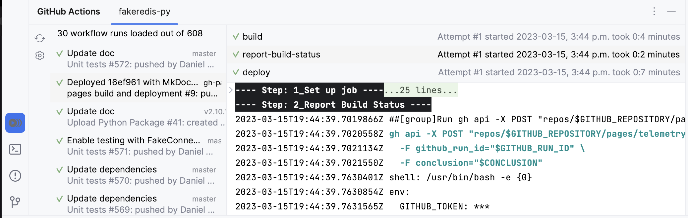</td>
    <td width="50%">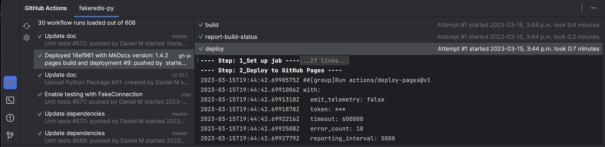</td>
  </tr>
</table>

Prefer a sidebar? Dock the tool window to the side and the three panels stack vertically:

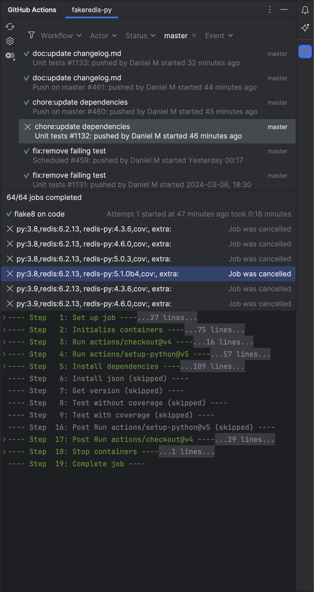

### Dispatch a workflow with inputs

Every `workflow_dispatch` input gets the right control — a checkbox for a boolean, a dropdown for a choice or an
environment:

<table>
  <tr>
    <td width="50%">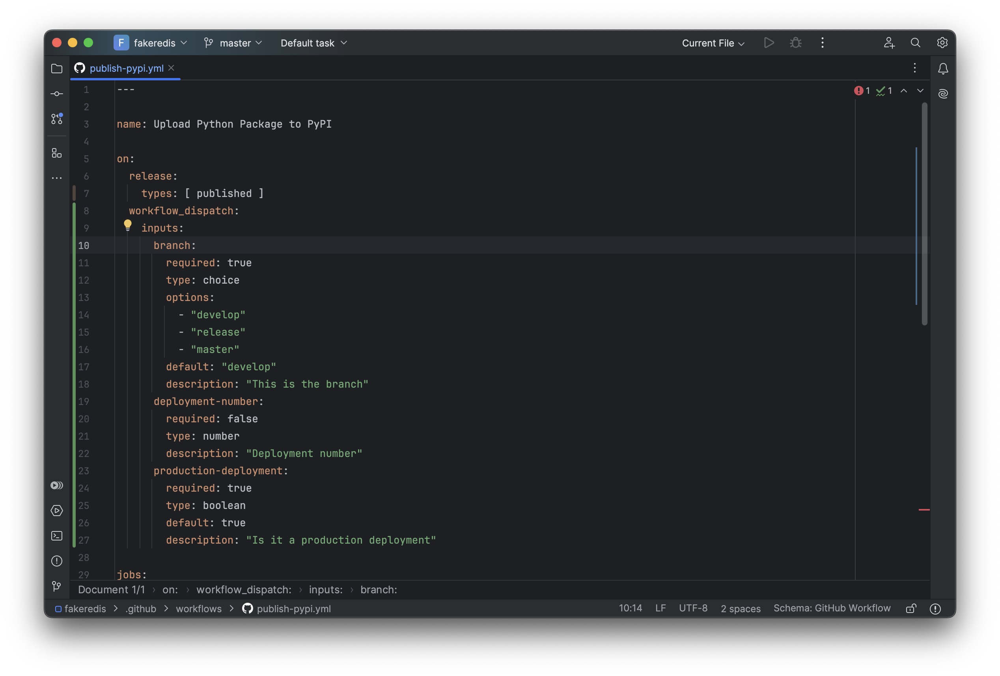</td>
    <td width="50%">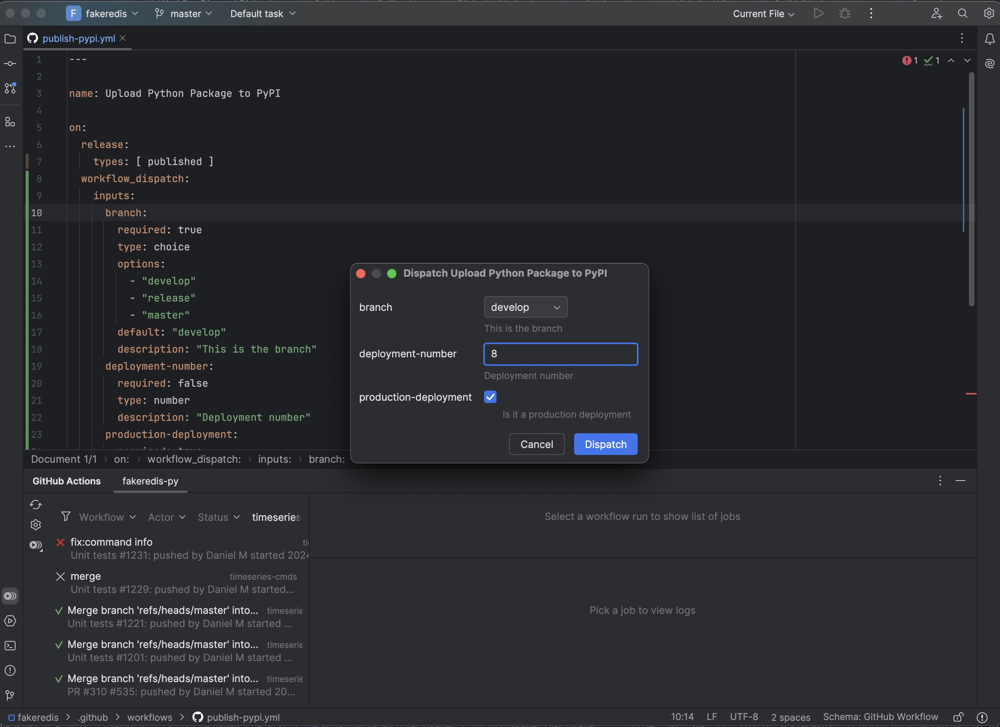</td>
  </tr>
</table>

### Approve deployments

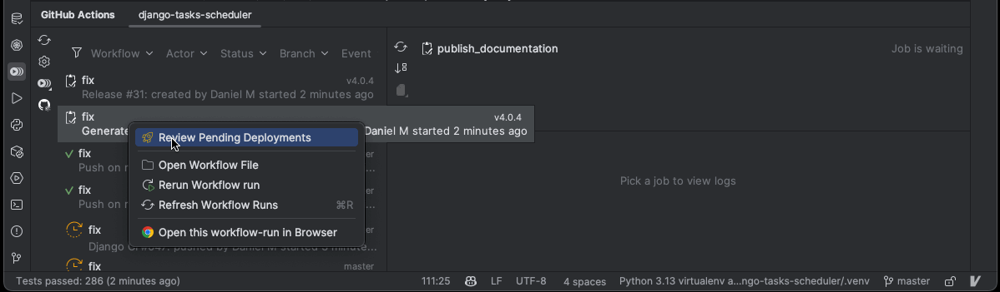

### Repository settings

Secrets, variables, environments and caches without opening the browser:

<table>
  <tr>
    <td width="50%">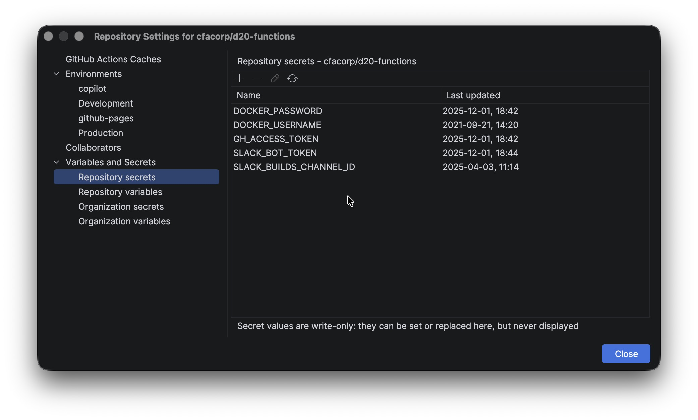</td>
    <td width="50%">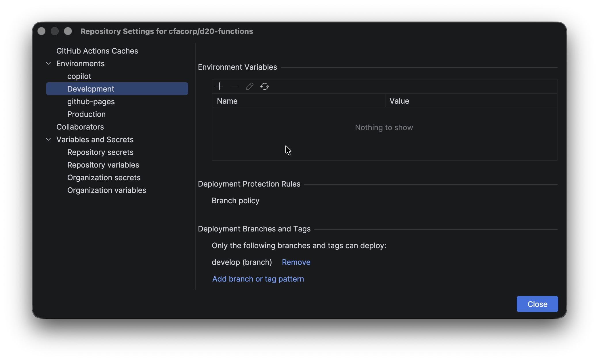</td>
  </tr>
</table>

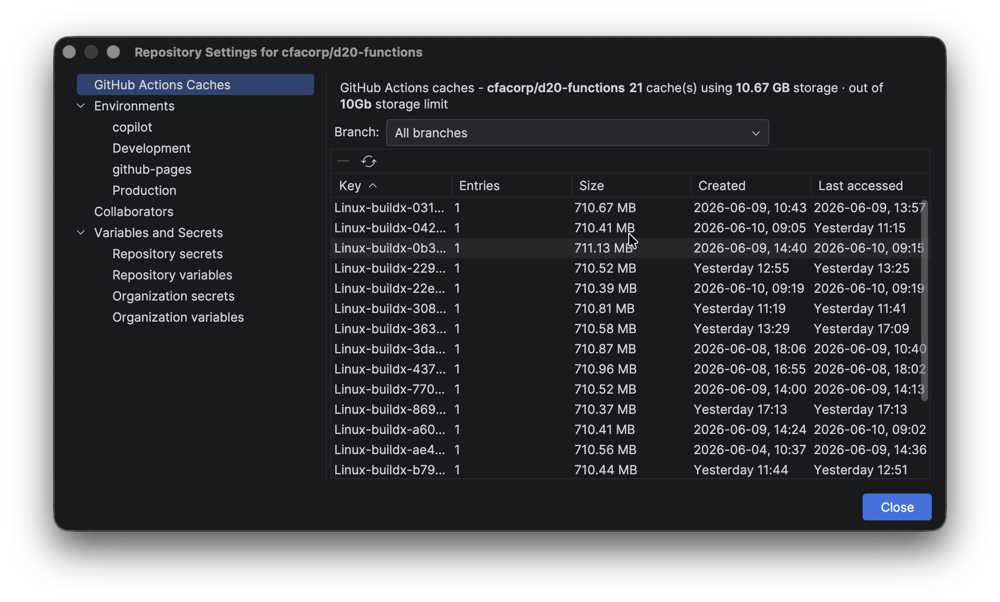

### Workflow file checks

An outdated action is highlighted, and a quick-fix bumps it:

<table>
  <tr>
    <td width="50%">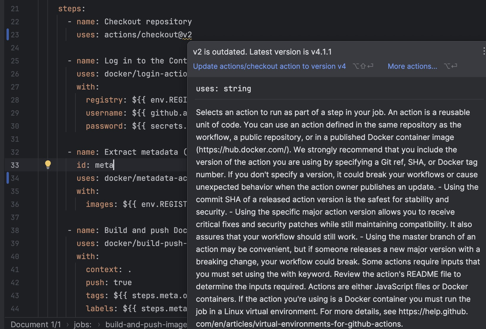</td>
    <td width="50%">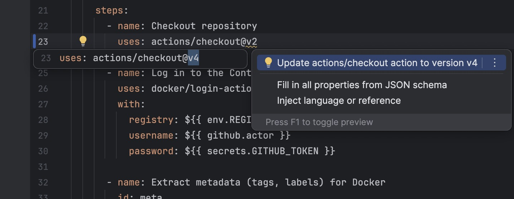</td>
  </tr>
</table>

### Link to file lines on GitHub

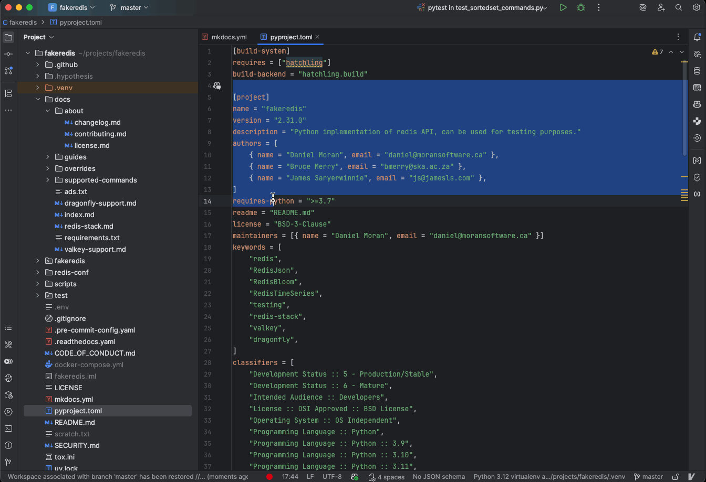

### Make it yours

Use a custom token, choose the layout and the refresh interval, and pick the GitHub account (or hide the tab) for each
repository:

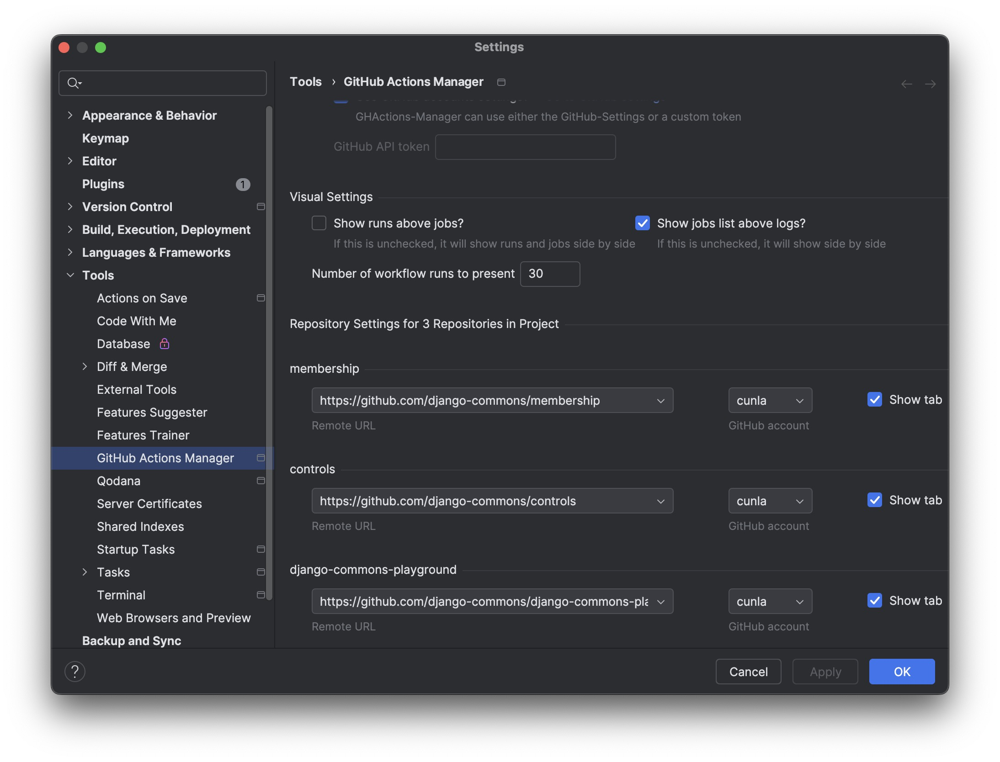

## Built for GitHub Enterprise and corporate networks

- **GitHub Enterprise Server** is supported next to GitHub.com, with a GitHub account per repository when a project
  mixes both.
- **Your network settings are honored**: the IDE's HTTP proxy (including authenticating proxies), its trusted server
  certificates, and the connection timeout of its GitHub settings.
- **Your token stays with GitHub.** It is sent to your GitHub server only. Logs and artifacts are served from a storage
  host, and the plugin follows that redirect without the token.
- **Secrets are sealed locally.** A secret's value is encrypted on your machine with the repository's (or
  organization's) public key before it is uploaded, exactly as GitHub's API prescribes.
- **Polite to the API.** Finished runs and jobs are not polled again, a rate limit pauses the refresh until it resets,
  and the refresh interval is yours to set.
- **No tracking.** No analytics and no third-party services: the plugin only talks to GitHub. An error report opens a
  pre-filled GitHub issue in your browser — you read it before you send it.

## Requirements

- A JetBrains IDE, version **2026.3** or later (IntelliJ IDEA, PyCharm, WebStorm, GoLand, PhpStorm, RubyMine, CLion,
  Rider, …). Older IDEs keep receiving the last compatible version from the Marketplace.
- A GitHub account configured in the IDE, or a personal access token. A token needs access to the repository
  (`repo` scope for a classic token); organization-level secrets, variables and runners need matching organization
  permissions.

## FAQ

**Is it really free?** Yes — watching runs, jobs and logs, the filters and the workflow-file checks need no license and
have no time limit. The license covers the features that act on GitHub or go beyond viewing.

**Nothing shows up in the tool window.** The project needs a git remote that points at GitHub, and a GitHub account (or
token) the plugin can use. The tool window links to both settings pages when one is missing.

**A repository uses another account than my default.** Assign an account per repository in <kbd>Settings</kbd> →
<kbd>Tools</kbd> → <kbd>GitHub Actions Manager</kbd>.

**I'm hitting the API rate limit.** Raise the refresh interval in the plugin settings. Only the selected repository
tab is refreshed, and only runs and jobs that can still change.

## Support

- 🐛 Found a bug or have an idea? [Open an issue][issues].
- 🔒 Security concern? See [SECURITY.md](SECURITY.md).
- 📋 Release history: [CHANGELOG.md](CHANGELOG.md).
- ⭐ If the plugin saves you time, a [Marketplace review][reviews] helps other developers find it.

[marketplace]: https://plugins.jetbrains.com/plugin/19347-github-actions-manager

[reviews]: https://plugins.jetbrains.com/plugin/19347-github-actions-manager/reviews

[issues]: https://github.com/dsoftwareinc/ghactions-manager/issues
